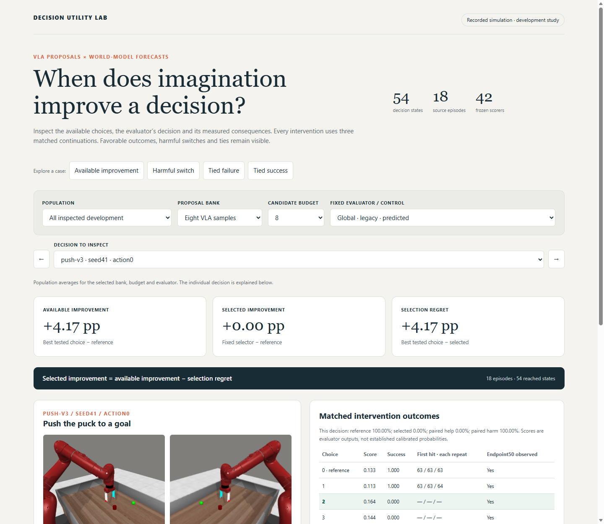

# Decision Utility Lab

An audit toolkit for action selection in vision-language-action (VLA) and latent world-model systems.

The central question is practical: **does choosing a different action help, or does the candidate bank leave nothing useful to choose?** The toolkit separates available improvement from selection error using matched simulator continuations. It includes the research modules, CPU tests, and a recorded Meta-World demonstration.



## Try it

Open [`demo/index.html`](demo/index.html) locally. Keep `demo/assets/` beside it. The demo runs without a server, GPU, or model download. A GitHub file preview shows the HTML source; download or clone the repository to use the controls.

```bash
git clone https://github.com/smhajimirzaei/decision-utility-lab.git
cd decision-utility-lab
python -S scripts/audit_decisions.py --input demo/inputs.json --output runs/example
```

The audit command uses only the Python standard library and requires Python 3.10 or later. It writes a JSON report and CSV decision table. Use a new output directory for each run.

For development:

```bash
python -m pip install -e ".[test]"
python -m pytest -q
```

## What the study found

The included data covers three manipulation tasks, 18 source episodes, and 54 reached decision states. Each candidate has three matched continuations. Both proposal banks, candidate budgets of four and eight, and all 42 frozen scorers are retained.

For the eight-sample VLA bank, the reference achieved **52.78%** episode-weighted intervention success. Choosing the best tested candidate after observing outcomes gives **56.94%**, an optimistic ceiling. Only **3 of 54 states** had a measured helpful alternative. The latest cohort had none.

This limits what a selector can achieve on these choices. Some future scorers made harmful switches; the study does not establish a deployed imagination benefit. The demo keeps those cases visible alongside improvements and ties.

See [results](docs/results.md) for the cohort comparison and [methodology](docs/methodology.md) for the intervention contract and weighting. These are development observations, not a final test or a combined closed-loop controller evaluation.

## What is here

| Path | Contents |
|---|---|
| `src/trust_imagination/decision_audit.py` | Model-independent validation and decision metrics |
| `src/trust_imagination/` | Proposal construction, simulator branching, model adapters, and research readouts |
| `scripts/audit_decisions.py` | Standard-library audit command |
| `scripts/build_demo.py` | Rebuild the portable demo from cached audit inputs |
| `scripts/analyze_*.py` | Trace and intervention analyses for raw research exports |
| `configs/` | Experiment settings and pinned upstream model manifests |
| `tests/` | CPU tests for contracts, metrics, readouts, and matched outcomes |
| `demo/` | Recorded data, native observations, source videos, and verification records |
| `docs/` | Methods, schema, results, and reproduction notes |

The packaged demo is enough to reproduce the decision audit. Full simulator/model collection needs separate upstream downloads and a compatible research environment; see [reproduction notes](docs/reproduction.md). Model weights, raw latent archives, and cloud account configuration are not part of this release.

## Reading the demo

- The cards summarize the selected population; the panels below explain one decision.
- “Best measured” uses outcomes and is an offline control, not a deployment method.
- Images are native observations. Videos show the recorded source policy, which is separate from the forked interventions.
- JEPA predicts latent features. The demo does not present generated future videos.
- Three repeats give coarse observed frequencies. Candidate branches and adjacent states are not independent episode samples.

## Background

The study uses [Meta-World](https://github.com/Farama-Foundation/Metaworld), [SmolVLA / LeRobot](https://github.com/huggingface/lerobot), and [JEPA-WMs](https://github.com/facebookresearch/jepa-wms). Relevant work on verification, planning range, and action discrimination is collected in the [research notes](docs/research.md).

A project license has not been assigned yet. Third-party software and simulator assets retain their upstream licenses; see [third-party notices](THIRD_PARTY_NOTICES.md).
