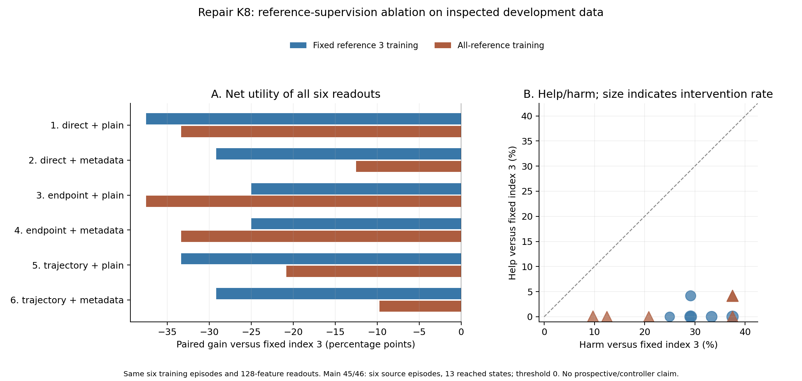

# Comparative readout follow-up

The wider repair bank created one additional measured opportunity, but none of the tested selectors beat a strong fixed-action control. This makes the next question more specific: can deployment-available forecasts predict **paired benefit over that control**, across changes in proposal construction and search budget?

## Proposal repair and unchanged scorers

The repair cohort uses seeds 45/46 across reach, push, and door opening: six source episodes and 13 reached decision states, with three matched continuations per candidate. The wider repair bank uses radius 0.25; the mixed bank uses 0.1. Their shared first four choices are identical.

At K8, fixed logical index 3 achieved 87.50% episode-weighted intervention success. The repair bank's measured offline ceiling was 91.67%, versus 87.50% for the mixed bank. Repair uniform selection lost 6.94 percentage points against mixed uniform selection. The added opportunity occurred only at reach seed 46, step 50. A larger radius therefore created both useful and harmful choices.

All 42 existing heads were evaluated unchanged. Twenty-one recognized the added repair opportunity, including action-only heads. The best aggregate among the 42 was 79.17%, below fixed index 3. The [complete frozen-head table](data/repair_frozen_heads.csv) retains all heads, banks, budgets, and the separate timing pilot. Recognizing that one case does not establish an advantage from world-model forecasts.

## Two CPU readout experiments

Six models compare direct/action inputs, the predicted endpoint, and the full chronological forecast, each with and without bank metadata. They share a cosine random-feature map of width 128, map seed 701, ridge penalty 0.1, and two paired help/harm outputs: 256 fitted coefficients plus two intercepts per model. The predictor remains frozen.

Both rounds trained on the same six historical source episodes, seeds 24/25, containing 18 states. Evaluation covered 67 states across 24 source episodes in four previously inspected cohorts: 27/28, 30/31, 41/42, and 45/46. The first round trained relative to fixed reference 3. The second trained on all ordered candidate/reference queries; inference still compared to reference 3. Repeated queries provide more supervision, not more independent episodes.

| Repair K8, threshold 0 | Fixed-reference training | All-reference training |
|---|---:|---:|
| Direct | 50.00% | 54.17% |
| Direct + metadata | 58.33% | 75.00% |
| Endpoint | 62.50% | 50.00% |
| Endpoint + metadata | 62.50% | 54.17% |
| Trajectory | 54.17% | 66.67% |
| Trajectory + metadata | 58.33% | 77.78% |
| Fixed index 3 | 87.50% | 87.50% |
| Measured offline ceiling | 91.67% | 91.67% |

Values are episode-weighted intervention success, rather than full-controller success. All 12 model instances lost utility at threshold 0. Some conservative thresholds removed measured harm, but none added success over index 3 on this cohort. Zero gain can include switches on outcome ties.

The trajectory change is a debugging lead. Endpoint performance worsened under all-reference supervision, and the direct metadata model also improved substantially. These results do not isolate a forecast advantage. Training contained only one state with helpful alternatives to index 3, and only three with any candidate-dependent paired help under arbitrary references; none of those three was a reach state.

Every model, bank, budget, and predeclared threshold is retained in the [fixed-reference](data/fixed_reference_readouts.csv) and [all-reference](data/all_reference_readouts.csv) tables. Each round has 432 records. Each independent metric verifier checked 116,970 scalar values, and each run separately reconstructed 21,168 probability values. Those checks establish implementation consistency; they do not increase the scientific sample size.

## Fresh collection status, October 14, 2026

The [separate frozen study](trajectory-study.md) plans 36 source episodes. Its first shard, seeds 47/48, is complete: **six training episodes, 16 reached states, 768 unique main candidate/repeat traces, and 48 exact base-policy continuation replays**. The physical base policy uses candidate 0; the comparative scorer reference remains logical index 3.

The timing pilot, seed 59, has three states, 144 traces, and nine base-policy replays. It is excluded from fitting and scientific aggregates. Collector runtime was 49.23 minutes, including the pilot and model loading.

All 1,076 regular export members passed hash verification, and the physical trace validator found no missing main grid cell. A read-only deployment-feature audit passed 864 feature blocks and 8,016 contract assertions across all 16 states, three banks, K4/K6/K8, and six feature specifications. Checks covered finite inputs, shared current/action blocks, reference differences, common-four bank equivalence, endpoint/trajectory alignment, and independence from outcome, support, actual-future, and goal keys. Earlier predicted frames affected trajectory features without affecting endpoint features. The [feature verification record](data/fresh_feature_verification.json) preserves the counts and source digests.

These are integrity results. No fresh head fitting, threshold selection, performance aggregate, or evaluation-group scoring has occurred. Six of 36 planned source episodes are complete; the next shard remains uncollected because GPU start requests failed on capacity. Evaluation seeds 56–58 have not been opened for performance analysis; reserved seeds 32–39 remain unopened.

The recorded demo still represents the original 18-episode audit. It does not include these newer cohorts or imply a prospective controller improvement.
