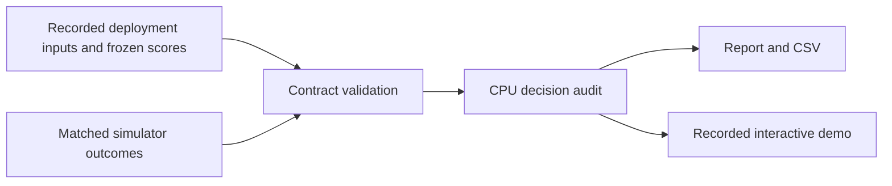

# Matched intervention audit

Each decision starts from a recorded source-policy state. Candidate zero is the reference intervention. Alternatives execute from that same state, with the same continuation seed within each repeat. Snapshot restoration and exact reference replay are checked during collection. There are three continuation repeats per candidate.

The policy bank contains eight VLA samples. The mixed bank shares the first four samples and adds four smooth translation perturbations. Physical duplicates are executed once, while logical multiplicity remains in bank metrics. The four-choice comparison is therefore an exact shared-candidate control.

## Outcome and metrics

Success means reaching the goal at any time before the remaining absolute episode horizon. First-success time and physical forecast support are offline instrumentation. A branch that stops early can succeed while lacking an observed endpoint at action 50.

For a fixed selector:

```text
gain        = selected success − reference success
opportunity = best tested success − reference success
regret      = best tested success − selected success

gain = opportunity − regret = paired help − paired harm
```

Paired help/harm compares binary outcomes within each matched repeat. A candidate may help in one repeat and hurt in another. Exact uniform selection averages logical candidates; score ties select the first index within a tolerance of 1e-10.

Average repeats within candidate, decisions within source episode, then source episodes equally. Otherwise episodes with more reached decisions would receive more weight. “Best tested” maximizes the same finite repeat means used for evaluation and can overstate the true opportunity.

## Input boundary

Deployment scores use current observations, candidate actions, and predicted features. Actual future features, first-hit times, success labels, privileged simulator state, and endpoint-support masks belong to the audit side. They cannot decide a deployment intervention.

The toolkit checks reference identity, continuation streams, duplicate physical/action identities, episode splits, score availability, outcome shapes, and timing consistency. It cannot prove that an external producer generated scores before inspecting labels; that requires a separately frozen collection protocol.



All included source episodes are inspected development data. Technical pilots and reserved final seeds are excluded. None of the measured branch rates is a deployed closed-loop controller success rate.
