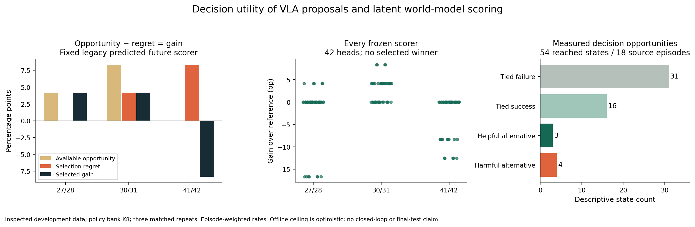

# Development results

The audit combines three cohorts, with six source episodes per cohort and three manipulation tasks: reach, push, and door opening. Reached decision states vary with the source trajectory. There are 54 states across 18 episodes, with three matched continuations per candidate.

| Eight-choice policy bank | Result |
|---|---:|
| Reference intervention success | 52.78% |
| Best tested choice, chosen offline | 56.94% |
| Available improvement | 4.17 percentage points |
| States with helpful alternatives | 3 |
| States with harmful alternatives | 4 |
| Tied failures | 31 |
| Tied successes | 16 |

Rates weight episodes equally. State counts describe the recorded population; they are not independent sample counts. “Helpful” means a tested alternative has a higher observed repeat mean than candidate zero. The latest cohort contributes 16 states with no measured helpful alternative.

The legacy global predicted-future scorer gained 4.17 points on each earlier cohort and lost 8.33 points on the latest cohort. Its descriptive combined gain is zero. Stronger direct/action controls and all other frozen scorers remain in the report; no model was selected as a deployed winner.

The final cohort includes both an early-success harmful switch and a harmful switch with complete physical endpoint support. Missing terminal endpoints do not explain every ranking error. At the same time, the small number of helpful choices limits the evidence for any benefit estimator.

## Verification

The adapter reproduced 504 existing model/bank/budget/cohort aggregates and 3,024 metrics. Independent integer-count and episode-weight calculations matched the report. Browser checks covered the choices, rendered controls, native camera dimensions, videos/playback, and a 390-pixel mobile viewport. Detailed records are in `demo/verification.json`, `demo/independent_verification.json`, and `demo/browser_verification.json`.

## Interpretation

The result identifies an opportunity bottleneck and concrete harmful rankings. It does not establish a reliable selective controller, language generalization, or a universal limit of world models. The offline ceiling uses few repeats and only the tested candidate bank. Forecast-generation cost is also absent from the cached-head scoring comparison.

The subsequent proposal-repair and comparative-readout experiments are reported in [the October follow-up](comparative-readouts.md). They retain the unfavorable comparisons against a strong fixed-action control. The [separate 36-episode study](trajectory-results.md) is complete and retains the negative primary result. Its development cohort is separate from this recorded audit.
