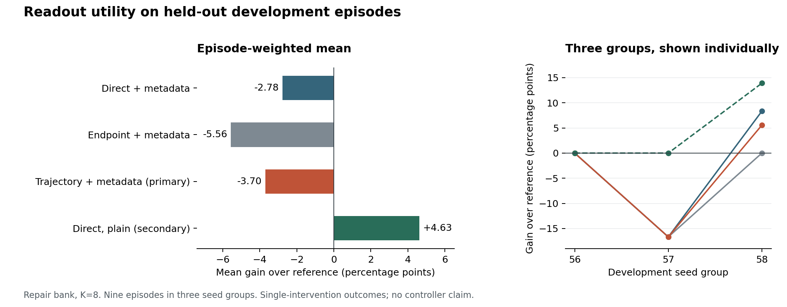

# Completed trajectory readout study

October 16, 2026. The predeclared trajectory readout did not improve selection over its matched direct/action control. The full result is retained, including the stronger secondary action-only ablation.

## Study design

The study collected 36 source episodes across reach, push, and door opening. Whole seed groups separate fitting, calibration, and development evaluation.

| Split | Seed groups | Episodes | Reached states |
|---|---|---:|---:|
| Training | 47–52 | 18 | 54 |
| Calibration | 53–55 | 9 | 26 |
| Development evaluation | 56–58 | 9 | 26 |

The technical pilot is excluded. Reserved confirmation seeds remain unopened. Each tested candidate has three matched continuations; branches and adjacent states do not count as independent task episodes.

Six readouts compare current-state/action inputs, the predicted endpoint, and the chronological forecast, each with and without bank metadata. They have the same fitted parameter budget. Reference action 3 was fixed using older development evidence before this collection. It is distinct from physical base-policy replay, which uses candidate 0.

Fitting and calibration use policy/mixed banks at budgets four and eight. Repair construction and budget six are held out. Models and thresholds were frozen before evaluation. The [protocol](trajectory-study.md) gives the feature contract, weights, calibration rule, and advancement criterion.

## Primary comparison

Rates weight source episodes equally. Help and harm are paired differences against reference 3, averaged over matched repeats and reached states within each episode. Switch frequency includes changes that tie the reference outcome.

| Repair bank, K8 | Success % | Gain vs reference (pp) | Help % | Harm % | Switch % |
|---|---:|---:|---:|---:|---:|
| Reference 3 | 55.56 | 0.00 | 0.00 | 0.00 | 0.00 |
| Direct + metadata | 52.78 | −2.78 | 2.78 | 5.56 | 69.44 |
| Endpoint + metadata | 50.00 | −5.56 | 0.00 | 5.56 | 88.89 |
| **Trajectory + metadata — primary** | **51.85** | **−3.70** | **1.85** | **5.56** | **63.89** |
| Direct, plain | 60.19 | +4.63 | 4.63 | 0.00 | 55.56 |
| Endpoint, plain | 55.56 | 0.00 | 0.00 | 0.00 | 63.89 |
| Trajectory, plain | 55.56 | 0.00 | 0.00 | 0.00 | 44.44 |
| Uniform | 52.08 | −3.47 | 0.93 | 4.40 | 87.50 |
| Best measured offline | 60.19 | +4.63 | 4.63 | 0.00 | 100.00 |

All six frozen calibration thresholds were zero. This applies the positive predicted-benefit rule without an additional positive margin; it does not mean the models always switch. A zero-gain readout can still switch on outcome ties.

| Trajectory + metadata minus | Mean difference (pp) | Seed 56 | Seed 57 | Seed 58 |
|---|---:|---:|---:|---:|
| Direct + metadata | −0.93 | 0.00 | 0.00 | −2.78 |
| Endpoint + metadata | +1.85 | 0.00 | 0.00 | +5.56 |

The first predeclared contrast is nonpositive, so the **advancement condition failed**. Beating the endpoint ablation does not rescue the result: both remain below the fixed reference. No prospective controller-benefit claim follows.



The figure shows the actual three development groups rather than treating candidate branches as a larger sample. [PDF](figures/trajectory_study.pdf) and [SVG](figures/trajectory_study.svg) versions are available.

## Individual cases

The primary helps at reach/seed58, step 0, but harms push/seed57, step 0. The plain direct model captures the reach/seed58 and push/seed58 opportunities, both at step 0, without measured harm. All of its improvement comes from seed58. Matching the optimistic offline ceiling on this finite bank is not evidence of general optimality or an independently confirmed method chosen after scoring.

The primary also loses 5.56 points on mixed K8, a configuration seen during fitting/calibration. The weakness cannot therefore be attributed specifically to the held-out repair radius. Metadata-aware models underperform their plain counterparts here; that observation does not establish that metadata is generally harmful.

## Limits and interpretation

Only two of the 54 reached training states have helpful policy/mixed alternatives to reference 3. Both are push states, in groups 51 and 52; there are no positive reach or door-open training intervention examples. The study meets its predeclared definition of **data-limited training**. More candidate/reference queries would not create independent positive examples.

There is no demonstrated trajectory advantage in this model/data regime. That does not show that world models are universally unhelpful. Proposal coverage, forecast content, readout capacity, and the gap between a 50-action forecast and a continuation outcome up to step 400 remain different possible limitations. Three development groups cannot support a dependable harm guarantee or broad generalization.

The next step is a focused diagnosis of the saved errors, followed by a separately frozen replication if justified. Repeated tuning on these now-inspected episodes would not provide confirmation. A controller claim would also need a prospective whole-episode comparison and deployment cost measurements.

## Data and reproduction

- [`trajectory_study.json`](data/trajectory_study.json): matched binary outcomes for 26 development states and recorded selections for every model/bank/budget/mode combination.
- [`trajectory_summary.json`](data/trajectory_summary.json): all 108 readout and 72 control aggregates, including per-seed values.
- [`trajectory_readouts.csv`](data/trajectory_readouts.csv) and [`trajectory_controls.csv`](data/trajectory_controls.csv): complete flat tables. Rates are fractions; gains are differences in those fractions.

```bash
python -S scripts/summarize_trajectory_study.py --input docs/data/trajectory_study.json --output runs/trajectory
```

The command replays arithmetic from recorded choices and outcomes, not model predictions or fitting. It uses exact rational episode weighting before converting to floats. All 7,920 public aggregate/per-seed metric comparisons agree with the frozen evaluation within 1e-12. The original paired-outcome audit passed 59,400 scalar checks; these establish implementation consistency, not additional samples.

Raw traces and latents are omitted. Public provenance retains contract/model/evaluation digests without cloud configuration or machine paths. See [reproduction](reproduction.md) and the [data schema](trajectory-data.md) for the boundary between public arithmetic replay and full scientific reproduction.
